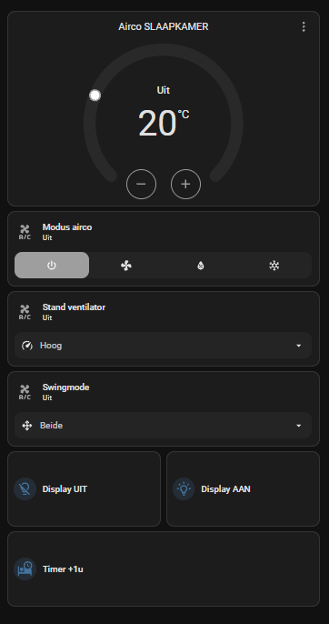

# Tristar AC-5407 + M5StickS3 + ESPHome

An **ESPHome / Home Assistant** controller for the **Tristar AC-5407** air conditioner using its **ZH/LT-01 IR protocol** and a **M5StickS3 ESP32-S3** with onboard IR transmitter.

**Release:** V10.8 (16 November 2026), working hardware tested by project owner. This repository is a **credential-free public copy** of that verified configuration. The publicly sanitized copy has not been compiled separately.

## Features

- Native ESPHome `zhlt01` climate entity (cooling, temperature, fan and swing modes supported by the device).
- Physical unit display ON (`0x00`) / OFF (`0x01`) using the captured LAMP command `0x0B`.
- **Real air-conditioner timer, +1 hour per button press** using timer command `0x06`; hours **1–11** were verified on the unit display. The unit handles the timer internally, not Home Assistant.
- Home Assistant button entities suitable for future Zigbee-button automations.
- A sensor indicating the **last timer hour value transmitted by the S3** and a **local counter reset** button.

## Hardware

- Tristar AC-5407 air conditioner and ZH/LT-01 remote (for initial verification).
- M5Stack M5StickS3 (ESP32-S3) with built-in IR LED.
- USB power, ESPHome Device Builder, Home Assistant.

The included YAML transmits IR on **GPIO46** and initializes the onboard M5PM1 power chip using **I2C GPIO47 / GPIO48**. **Do not attach external 5 V power to the Grove/EXT_5V port while the board is in output-power mode.** This code is specific to the M5StickS3 hardware described here; do not flash unchanged to other boards.

## Installation

1. Back up your current working ESPHome device before changing anything.
2. Add `tristar-ac5407-slaapkamer.yaml` to ESPHome Device Builder, or adapt the device name to your setup.
3. In your private ESPHome `secrets.yaml`, add the four keys shown in `secrets.yaml.example` **with your own real values**. If you already have `wifi_ssid` and `wifi_password`, keep them.
4. Create an ESPHome API encryption key using the ESPHome key generator/ESPHome dashboard. If replacing an existing key on an already paired device, update the Home Assistant ESPHome integration as required.
5. Validate, compile, flash and pair the device through ESPHome. Aim the IR LED at the air conditioner.
6. Check climate control, display ON/OFF and timer increments 1 → 2 → 3 hours.

**Never copy placeholder credentials to a live device.** The `secrets.yaml.example` is documentation only.

## Timer behavior and limitations

The `Tristar IR Timer +1 uur` button sends absolute hour values 1, 2, 3 ... 11 in successive presses; it does not emulate a long press and does not use the older software countdown. These values were tested on the actual air-conditioner display. The S3 remembers only the last transmitted number while powered. The number **is not** the remaining countdown, and the air conditioner cannot report its timer state back via this one-way IR link.

The button `Tristar IR timer teller reset (alleen S3)` resets the **S3 counter only**; it does **not** cancel the unit's timer. After ESP restart, use of the original remote, or timer expiry, the unit and the S3's counter may diverge. Climate mode in Home Assistant must be ON for the timer and display commands to be sent.

## Privacy and security

- No real Wi-Fi password, fallback hotspot password or ESPHome API encryption key is included.
- Your real `secrets.yaml` must **never** be committed.
- Historical ZIP backups may contain actual credentials; **do not publish historical HAOS archives**.
- If a real key was ever exposed to an unauthorized party, rotate it.

## Attribution and technical notes

This project documents observed behavior on one Tristar AC-5407 with its ZH/LT-01 remote. Hardware variants may differ. No affiliation with Tristar, M5Stack, ESPHome or Home Assistant. The code builds on ESPHome's `zhlt01` climate platform.

See [CHANGELOG.md](CHANGELOG.md) for the changes made for this public release.

## Licensing

No explicit open-source license is included in this initial publication bundle. If you intend to grant reuse rights, choose an appropriate license after reviewing compatibility with any third-party code.

## Home Assistant Dashboard

The screenshot below shows the Tristar AC-5407 controller integrated into Home Assistant.

The dashboard provides temperature control, operating modes, fan speed, swing settings, display ON/OFF and native air-conditioner timer control.

